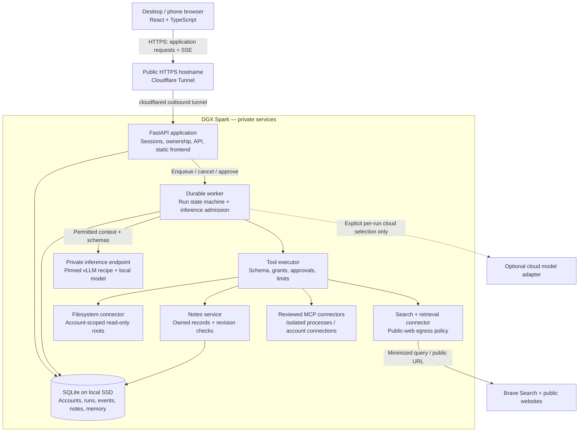
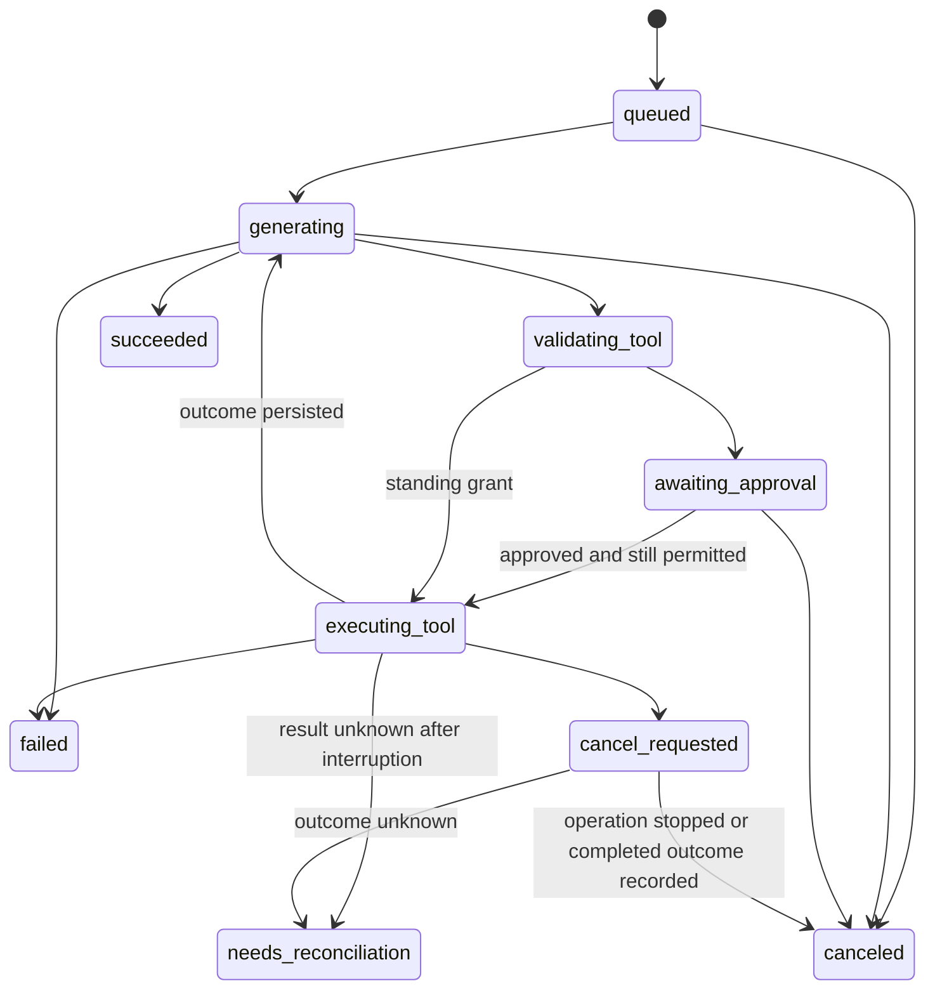

# Archer system architecture and tool decisions

Research checked: **October 21, 2026**. Status: **proposed design, incorporating the confirmed product scope; pending workflow priorities and Spark measurements**.

This architecture was originally drafted before implementation. On October 23, the GitHub main branch was found to contain a FastAPI/React scaffold, dependency lockfiles, starter plugins, and model adapters. Inspect and extend that implementation; do not replace it merely to match proposed paths or versions below. The design is a target, not evidence that integrations, security boundaries, or benchmarks have passed. This document supplements `archer v1 deepresearchplan.md`.

## Recommendation

Build V1 as a **modular Python application with a separate durable worker and model server**, deployed on the existing DGX Spark. Use a responsive React web client, FastAPI, SQLite, a permission-checked tool registry, and the official MCP Python SDK. Publish only the authenticated application through Cloudflare Tunnel.

Keep the confirmed original V1 scope: chat, approved files, web research, personal notes, inspectable preference learning, and an action journal. Optimize it for one person who wants general life management and useful agentic execution. “Average student” describes the intended user, not a schoolwork-only product. Preserve extension points for voice and devices without implementing them now.

“Optimal” means the best measured balance of task completion, response time, privacy, operating cost, and maintenance burden. New releases are research candidates. A release configuration must be pinned and tested as a complete combination of model, tokenizer, template, parser, inference image, driver, and hardware.

## Product assumptions and decisions still needed

Confirmed by the user: retain V1; serve one person; support overall daily life rather than only schoolwork; emphasize management and agentic assistance; run locally where practical; target under $10/month; consider a useful API if justified; and use the available Spark for benchmarking. Possible willingness to share conversation data is not standing consent for automatic cloud routing.

Use one owner account and one active foreground assistant run initially. Multiple tabs and conversations can exist, but additional runs queue with visible status. Preference extraction yields to foreground work. Keep ownership fields and account-isolation tests from the roadmap, while deferring polished invitation management until another user is needed. Throughput capacity remains unmeasured.

The remaining product detail is which existing apps Archer should connect to first. Benchmark execution also needs a safe connection method or hardware output from commands the user runs themselves. Connection details are optional for completing this design; no password, private key, or token should be shared in chat. No Spark connection details have been supplied yet, and local SSH configuration contains no named host aliases.

Follow-up product decisions: which apps hold commitments, tasks, and notes; which note changes may proceed under standing grants; and whether research should favor quick answers or deeper source checking. A calendar or email integration is optional reviewed-plugin work, not assumed permission to read accounts, create events, or send messages.

If the audience becomes unrelated customers, revisit PostgreSQL, identity management, operations, and service availability. Voice remains V2 unless the user changes scope.

### General management workflows within the existing scope

Proposed first demonstrations, pending priority selection:

1. Capture commitments, errands, ideas, and deadlines from the user's messages or approved files; flag ambiguous dates and save an organized personal note with source references.
2. Turn commitments, priorities, and stated availability into a daily or weekly plan; explain conflicts and save the agreed plan through the notes tool.
3. Research an everyday question or decision, show supporting sources, and save useful findings; apply explicit corrections and useful personal preferences in later conversations.

Represent the first commitment ledger as structured note content. A dedicated task engine, automatic reminders, and scheduled execution are not silently added to V1. Dates use an explicit account timezone; missing dates and timezones remain questions rather than guesses. External event creation requires a selected connector and an appropriate grant. Broader assistance expands through reviewed connectors; the phrase “everything” does not imply that V1 can already control arbitrary applications or devices.

## System and trust boundaries

Arrows describe logical dependencies. Gateway, worker, and notes share one codebase; they are not independently deployed microservices. Untrusted connectors and inference have separate runtime boundaries. Start with one worker process; it may run a small bounded number of asynchronous read/model tasks after capacity tests.

The model proposes actions. Core establishes identity, authorizes actions, executes them, and records outcomes. No model response, learned preference, document, or MCP description can grant authority.

Cloudflare Tunnel establishes outbound connections from the origin, allowing the home gateway to avoid inbound port forwarding. It is transport, not Archer’s account authorization system. HTTPS terminates at the provider edge, so the tunnel is not end-to-end encryption that hides application traffic from that provider. [Cloudflare Tunnel](https://developers.cloudflare.com/cloudflare-one/networks/connectors/cloudflare-tunnel/), [TLS connections](https://developers.cloudflare.com/ssl/concepts/)

## Proposed stack

| Layer | Choice | Reason and boundary |
| --- | --- | --- |
| Browser | React 19.3, TypeScript, Vite 8.3 release line | Responsive authenticated application. Build static assets and serve them from the same application origin. |
| Frontend data | Typed API client generated from OpenAPI; native EventSource | Avoid two hand-maintained definitions of the API. REST handles commands; SSE handles server events. |
| Application | FastAPI, Pydantic v2, Uvicorn | Python aligns with local inference and connector libraries. Strict request and tool schemas. |
| Python runtime | Start application compatibility testing on Python 3.14 | Maintained bugfix line; evaluate 3.15 once the selected ARM dependencies pass. Inference uses its recipe’s own runtime. |
| Persistence | SQLite WAL + SQLAlchemy 2.x + Alembic | Small private single-host deployment; short transactions, migrations, durable jobs and events. |
| Run execution | Archer-owned bounded state machine + database job table | One foreground run; clear approval, cancellation, reconciliation, and retry semantics. Avoid a second workflow database in V1. |
| Model serving | vLLM in a Spark-compatible container | Initial evaluation backend. Use the exact hardware/model recipe, not generic installation commands. |
| Model | Benchmark Qwen3.8-27B NVFP4 first | Candidate, not a declared quality or latency winner. Alternatives below. |
| External connectors | Official MCP Python SDK v2 | Reviewed stdio connectors locally; Streamable HTTP for appropriate remote connectors. |
| Search | Brave Search API, with LLM Context evaluated separately | Preserve sources and let the local model synthesize the answer. |
| Notes and preferences | Owned SQL records; FTS5 text retrieval | No extra embedding service required for the first small corpus. |
| Authentication | Invite-only local accounts, Argon2id, opaque server-side sessions | Keeps identity local. Session rotation, revocation, CSRF protection, login throttling, owner recovery. |
| Deployment | Docker Compose; host service startup; local SSD volumes | Reproducible single-server installation and recovery. |
| Development | pnpm, uv, Ruff, type checking, pytest, browser integration checks | One JS lockfile and one Python lockfile; pin runtimes and build images. |
| Observability | Structured redacted logs, run journal, operational metrics | Begin locally; add an OpenTelemetry collector when cross-service diagnosis warrants it. |

Current documentation identifies React 19.3, Vite’s supported 8.3 line, and MCP Python SDK v2 as current release lines. These are research baselines; resolve and lock exact compatible patches when implementation begins. [React versions](https://react.dev/versions), [Vite releases](https://vite.dev/releases), [MCP SDK](https://py.sdk.modelcontextprotocol.io/)

Use Node 24 LTS for the build toolchain initially. Node’s October 21 release list includes 24.22.1 LTS; the 26 line is still marked Current in that list. Recheck support status when scaffolding. Node is not needed to serve the built frontend. [Node releases](https://github.com/nodejs/node/releases)

Python currently lists 3.15 as the newest stable line and 3.14 as a maintained bugfix line. Start dependency verification with 3.14; move to 3.15 if the complete application stack installs and passes on ARM. This is a compatibility decision, not an assertion that 3.15 is unsupported. [Python releases](https://www.python.org/downloads/)

React’s documentation supports a Vite-based application while explaining that routing and data fetching become application choices. This fits Archer because FastAPI already supplies the backend and the private application does not need search-engine rendering. [React application setup](https://react.dev/learn/build-a-react-app-from-scratch)

Use `uv.lock` and `pnpm-lock.yaml`, frozen/locked installs, and an explicit update review. Do not deploy floating package versions or image tags. uv documents lockfile-based project synchronization. [uv locking](https://docs.astral.sh/uv/concepts/projects/sync/)

## Inference research: shortlist and selection procedure

### First candidate: Qwen3.8-27B NVFP4

NVIDIA’s October Spark guidance lists `nvidia/Qwen3.8-27B-NVFP4` for both memory configurations, with different launch configurations. The 128 GB recipe records a tested image digest, a 0.60 memory target, kernel settings, and a draft model; it also notes startup and prefix-cache correctness considerations. Preserve the recipe as a unit during evaluation. The listed image is a prerelease; a vendor recipe is evidence to test, not production certification. [Spark model setup](https://build.nvidia.com/spark/vllm/intermediate)

The quantized checkpoint’s card identifies Apache-2.0 licensing. Test its actual supported inputs; the base model’s image capabilities do not establish that every quantized artifact supports the same path. V1 needs text only. [Quantized checkpoint](https://huggingface.co/nvidia/Qwen3.8-27B-NVFP4), [base model card](https://huggingface.co/Qwen/Qwen3.8-27B)

### Challenger: Nemotron 3.5 Bolt 74B-A9B 24GB

The current model card describes a 74B total / 9B active model with native 2-bit packing, under OpenMDW-1.1. Its setup includes specialized kernels, a reasoning parser, remote code, and a nightly inference image. That makes it an interesting efficiency challenger with more runtime integration work. The packed model size is not the total serving-memory requirement. Review and pin downloaded executable code before use. Do not carry broad local-media filesystem flags from a demonstration into Archer. [Bolt model and deployment requirements](https://huggingface.co/nvidia/NVIDIA-Nemotron-3.5-Bolt-74B-A9B-24GB)

### Larger candidate: Qwen3.8 Flash-Next

For a confirmed 128 GB Spark, investigate NVIDIA’s Spark-specific FP4-Local recipe as a later comparison. The generic model recipe also describes multi-GPU configurations; do not transplant those commands into a single Spark. Treat this candidate as optional until runtime headroom and application latency are measured. [Spark-specific recipe selector](https://nvidia.github.io/local-ai-inference-recipes/hardware/dgx-spark/index.html?backend=vllm&memory=128&memoryConfig=128&model=qwen/qwen3.8-flash-next&os=linux&precision=fp4-local&variant=), [generic model recipe](https://recipes.vllm.ai/Qwen/Qwen3.8-Flash-Next)

### Inference engine alternatives

Start evaluation with vLLM because the current Spark playbooks provide model-specific serving paths. Keep the model adapter replaceable. Compare llama.cpp if a GGUF path proves easier to operate or faster for the actual workload; evaluate SGLang if its supported configuration resolves a measured problem. NVIDIA has playbooks for both. There is no measured engine winner for Archer yet. [vLLM playbook](https://build.nvidia.com/spark/vllm/choose-recipe), [llama.cpp playbook](https://build.nvidia.com/spark/llama-cpp), [SGLang playbook](https://build.nvidia.com/spark/sglang)

Tool calling requires the matching model template and tool parser. Valid JSON is not evidence that a proposed operation is authorized or correct. Archer validates the complete tool call before executing it; streamed argument fragments are display-only. [vLLM tool calling](https://docs.vllm.ai/en/stable/features/tool_calling/)

### Benchmark plan

First record the actual Spark model, available memory, storage, OS, driver, container runtime, and running workloads. Do not assume all unified memory is available to model weights. Reserve capacity for the OS, application, caches, request state, and any draft model.

1. Run 12 smoke cases per candidate: plain chat, tool selection, valid arguments, streaming, cancellation, long input, denied action, and basic recovery. Stop candidates that cannot run correctly.
2. Evaluate finalists on 30 fixed tasks, three repeats each: 6 general planning/commitment tasks, 6 research tasks, 8 notes tasks, 4 preference/correction tasks, and 6 ambiguous or failure cases. Keep input fixtures and tool outputs identical.
3. Test the actual one-user workload first, including multiple tabs and a queued background learning job. A two-client stress test verifies admission and queue behavior; four-client capacity testing is optional future work. Begin with a 16K context limit, then compare 32K if it improves the target tasks. These are proposed test settings, not capacity claims.
4. Measure time to first visible answer, time to first tool request, total task time, decode throughput, queue wait, peak system memory, startup time, and failures. Report median and p95 with sample counts; a small sample’s p95 is only directional.
5. Run isolation, prompt-injection, duplicate-operation, and crash tests against Core regardless of model scores. A quality score cannot compensate for a failed permission boundary.

Pick the smallest configuration that completes the agreed tasks at acceptable latency. Set the latency target with the user’s task priorities; there is no invented “optimal tokens/second” target. Do not run multiple large models concurrently until measurements justify it. Schedule preference extraction below interactive inference and bound its queue.

Store exact revisions, image digests, configuration, test fixtures, and raw results in a release manifest. No benchmark has been run in this session.

## Durable run design

This diagram shows the main path. Every wait also has expiry and failure handling. A denied tool call produces a recorded denial and may return control to the model for an allowed alternative within the run’s remaining budget.

Create a run and its job in one database transaction. The worker claims jobs with an atomic update, lease, heartbeat, and fencing generation; do not depend on a Python in-memory queue. Use one active executor during recovery. Lease ownership alone cannot fence an external side effect: never start a replacement write until the old operation is stopped or reconciled.

Record tool intent before dispatch and result afterward. For note changes inside Archer’s database, commit the mutation and operation result together. For external services, require a verified idempotency key or an operation-status reconciliation path before allowing automatic retries. An unknown write outcome becomes `needs_reconciliation`; do not promise exactly-once external execution.

An approval binds account, run, tool version, canonical argument digest, resource revision, expiry, and grant version. Recheck all of them immediately before execution. Editing a proposed change invalidates the prior approval. Standing grants avoid repeated prompts for explicitly permitted actions.

Cancellation prevents new steps and requests termination of active operations. The journal records completed effects even when the overall run is canceled. Browser disconnection does not cancel or duplicate a run. Worker loss may restart safe reads; uncertain writes require reconciliation.

FastAPI’s BackgroundTasks are useful for response-associated work, but Archer’s restart-sensitive runs need explicit persistent job state. FastAPI’s own guidance distinguishes simple background work from more substantial multi-process processing. [Background task guidance](https://fastapi.tiangolo.com/tutorial/background-tasks/)

### Streaming contract

- `POST /api/v1/conversations/{id}/runs`: accept an account-scoped client operation ID; return the existing run for a duplicate submission.
- `GET /api/v1/runs/{id}`: return durable state and a current output snapshot.
- `GET /api/v1/runs/{id}/events`: same-origin authenticated SSE; monotonic per-run sequence IDs; authorize ownership before replay and revalidate revocation while connected.
- `POST /api/v1/runs/{id}/cancel`: idempotently request cancellation.
- `POST /api/v1/approvals/{id}/decision`: bind a decision to the exact proposal.

Persist structural events before emitting them. Batch text deltas rather than writing a transaction per token. On reconnect, replay from `Last-Event-ID`; deduplicate by sequence number. If events have expired, return a snapshot with an explicit resume cursor. Do not hold a database transaction for the lifetime of a stream. Event retention and snapshot behavior must be documented.

FastAPI now documents native SSE responses, event identifiers, and Last-Event-ID handling; a separate SSE package is not automatically necessary. [FastAPI SSE](https://fastapi.tiangolo.com/tutorial/server-sent-events/)

## Data model, memory, and search

Core entities: accounts, sessions, conversations, messages, runs, jobs, run events, tool operations, approvals, connector connections, grants, notes, memories, memory evidence, and memory suppression records.

Every user-owned row has an immutable account owner. Use composite ownership checks and foreign keys so a child cannot reference another account’s parent. The authenticated account comes from the server session; never trust an account ID in model arguments. Authorization applies to listings, search indexes, streaming, exports, background jobs, and connector credentials as well as individual objects.

Notes include a revision number and soft-deletion state. Updates require an expected revision to avoid overwriting a newer edit. Keep history and explicit retention settings. Credential references point to a protected secret store or files; values never appear in model context or the action journal.

Memory is a separate interpretation of history. Store content, source message IDs, inferred/corrected origin, status, timestamps, and a learning epoch. A correction outranks inference. A deletion creates a suppression record for the relevant preference and evidence; increment the learning epoch, invalidate queued stale jobs, and remove retrieval entries. Historical messages may remain in chat history, but must not recreate a suppressed preference. Disable-learning controls prevent extraction and retrieval as configured.

Only user-authored conversation and explicit corrections supply preference evidence. Tool output and web instructions cannot become user preferences. Do not extract credentials or sensitive inferred traits. Routine suggestions stay descriptive in V1.

Start with curated preference retrieval and FTS5 for notes and supported text. Enforce account/document permissions before selecting context. Treat snippets and search-result counts as potentially private. Add hybrid semantic retrieval only after a fixture set demonstrates that lexical retrieval misses important tasks; then benchmark a local embedding model and account-scoped index. A vector database is not required merely because Archer uses an LLM. [FTS5 capabilities](https://www.sqlite.org/fts5.html)

### SQLite versus PostgreSQL

SQLite is appropriate for the assumed single-host private deployment if transactions remain short and write contention is measured. WAL permits readers alongside a writer, but there is still one writer at a time and the database must live on local storage. Keep inference and network calls outside transactions. Use an independent SQLAlchemy session per task. [SQLite WAL](https://www.sqlite.org/wal.html), [SQLAlchemy session concurrency](https://docs.sqlalchemy.org/en/20/orm/session_basics.html)

Verify the SQLite library loaded by the production Python runtime. SQLite documents a WAL-reset bug fixed in 3.51.3 and later, with selected backports. Require a supported patched build and verify the specific fix rather than assuming a new Python image supplies it. [SQLite WAL fix](https://www.sqlite.org/wal.html#walresetbug)

Choose PostgreSQL before implementation if multiple application hosts, substantial concurrent writes, shared team workspaces, or database-enforced tenant policies are required. PostgreSQL row-level security adds a useful boundary, but owner/BYPASSRLS roles can bypass it; configure a restricted application role and test policies. Migrating from SQLite requires data conversion and migration tests, not merely changing a connection URL. [PostgreSQL row security](https://www.postgresql.org/docs/current/ddl-rowsecurity.html)

## Tool contracts and connector safety

Every tool definition contains a versioned input/output schema, side-effect class, timeout, output limit, required scopes, resource constraints, and declared retry semantics. Those semantics are reviewed configuration, not model-controlled fields.

V1 tool surface:

- Files: `files.list`, `files.search`, `files.read`, restricted to approved roots and supported text formats.
- Research: `web.search`, and optionally `web.fetch_public` behind a separate egress boundary.
- Notes: `notes.list`, `notes.read`, `notes.create`, `notes.update`, `notes.trash`, with ownership and operation IDs.
- Memory controls: authenticated product APIs for inspect, correct, delete, and disable learning. Model tools cannot silently modify grants or erase evidence.
- MCP: reviewed tool names mapped into the same registry, never an unrestricted dispatcher accepting arbitrary server/tool names.

Use account-scoped file connector processes with only that account’s approved roots mounted read-only where practical. Reject traversal, symlink escapes, special files, and oversized inputs. Validate paths at file-open time using directory-relative/no-follow operations to avoid a check/open race. Do not give file or MCP containers the host root, Docker socket, shared credential directory, or unrestricted network access.

Remote MCP connections use separate account credentials and server identity checks. stdio launches are owner-configured fixed commands, not user-supplied shell strings. Treat advertised tools and schema changes as changes requiring review. Disable MCP sampling or other unsolicited model requests unless explicitly mediated through Archer’s provider policy.

The MCP specification treats tool annotations as untrusted. OAuth audience validation and avoiding token passthrough matter for remote integrations. Protocol support does not prove account isolation or safety. [MCP tools](https://modelcontextprotocol.io/specification/2026-07-28/server/tools), [MCP security](https://modelcontextprotocol.io/docs/2026-07-28/tutorials/security/security_best_practices)

For web fetching, restrict schemes, validate resolved IPv4/IPv6 destinations, pin the checked destination for connection, and recheck every redirect. Deny private, loopback, link-local, metadata, and local network destinations at both application and network boundaries. Apply content-type, size, redirect, and time limits. Source documents are untrusted data. [OWASP SSRF prevention](https://cheatsheetseries.owasp.org/cheatsheets/Server_Side_Request_Forgery_Prevention_Cheat_Sheet.html)

Brave’s LLM Context endpoint provides pre-extracted material and can reduce custom page-fetching work. Compare citation fidelity and task completion against ordinary search before selecting it. Keep retrieved source IDs, URLs, timestamps, and excerpt provenance. Check the selected plan’s storage rights before retaining search material in long-lived notes or caches. [LLM Context documentation](https://api-dashboard.search.brave.com/documentation/services/llm-context), [Brave plans and storage terms overview](https://brave.com/search/api/)

## Authentication and privacy

Use Argon2id through a maintained implementation, per-password salts, calibrated cost, and upgrade-on-login. Store only hashes. Issue random opaque session IDs in Secure, HttpOnly cookies; store a hashed session identifier server-side, rotate on login and privilege change, expire and revoke sessions. Protect writes with CSRF tokens and origin validation. Render assistant Markdown with unsafe HTML disabled and sanitize any supported extensions. [OWASP password guidance](https://cheatsheetseries.owasp.org/cheatsheets/Password_Storage_Cheat_Sheet.html), [session guidance](https://cheatsheetseries.owasp.org/cheatsheets/Session_Management_Cheat_Sheet.html)

For a broader audience, consider a maintained OIDC identity provider instead of expanding a custom account lifecycle. Its availability, cost, and privacy impact require a product decision. Cloudflare Access can be an optional outer invitation gate; application ownership checks remain mandatory.

Cloud inference selection is explicit per run. Freeze the provider policy when the run begins, and require a new user decision to change it. Background extraction inherits the same disclosure policy. Never silently send files or conversation history to a cloud fallback after local failure. Search queries and public page fetches remain external disclosures even when inference is local.

Operational logs contain request/run IDs, timings, tool names, and sanitized status; conversation content belongs in controlled application storage. No prompt or tool-result telemetry export by default. OpenTelemetry explicitly calls out protecting potentially sensitive telemetry. [OpenTelemetry security](https://opentelemetry.io/docs/security/)

Mark private API responses and event streams `Cache-Control: no-store` and bypass edge caching. Do not persist conversations in a frontend service-worker cache. Scope all application caches by account and grant version. Before enabling inference prefix-cache sharing across accounts, verify the engine’s isolation and side-channel controls; otherwise disable that optimization for private multi-user operation.

## Deployment, recovery, and costs

Use Compose with `app`, `worker`, `model`, `cloudflared`, and reviewed connector services. The frontend build is part of the app image. Containers use least privilege, scoped mounts, bounded logs, health checks, and restart policies. No public route to the model, database, metrics, or connector ports. Docker’s documentation supports Compose for a single-server deployment and explicit readiness checks. Health checks alone do not provide failover or recover unknown tool effects. [Compose production](https://docs.docker.com/compose/how-tos/production/), [startup readiness](https://docs.docker.com/compose/how-tos/startup-order/)

Back up SQLite through its online backup API, then encrypt and copy the consistent snapshot to a separate device/location. Back up application files with a manifest and verify their correspondence to database revisions. Keep keys separate. Test a clean restore, including grants, memory deletions, sessions, and unfinished operations. Restored sessions should be revoked and uncertain writes reconciled before workers resume. Retention policy must account for deleted data in older backups. [SQLite backup API](https://www.sqlite.org/backup.html)

Keep a private SSH or VPN path for administration. If users are comfortable installing a VPN client, Tailscale Serve is a private alternative to public browser access; Funnel exposes a service publicly. This changes the product’s onboarding, so retain the roadmap’s public hostname by default. [Tailscale Serve](https://tailscale.com/docs/reference/tailscale-cli/serve), [Funnel](https://tailscale.com/docs/features/tailscale-funnel)

The Spark, house power, and home Internet are single points of failure. A cloud inference adapter does not keep the application available during a Spark outage. If availability during outages matters, design a separate control-plane host, replicated state, and degraded mode after clarifying the requirement.

Treat **under $10/month for external services** as the initial budget target. The user has not specified whether electricity and domain purchase must fit inside that figure. Compute total ownership separately: domain + optional access plan + search + off-device backup + optional cloud inference + electricity. Electricity is measured average kW multiplied by hours and the local tariff; it is not assumed free.

Proposed monthly service envelope: at most $5 of paid search, at most $3 of explicitly enabled cloud inference, and $2 reserved for other service costs. This is a budget allocation, not vendor pricing or a promise that domain and backup costs fit. Start with cloud inference disabled and existing local/off-device storage where available; do not subscribe to extra services by default.

Brave currently advertises Search at $5/1,000 requests with $5 monthly credits. At that rate, 600 requests cost $3 gross and may be covered by applicable credits. Reserve against gross cost until eligibility is verified. The page also has broader promotional credit language, so confirm actual account eligibility and plan terms. [Brave pricing](https://brave.com/search/api/)

Benchmark a cloud API only if the local finalist fails an important personal-assistance task or its latency is unacceptable. Compare the actual benefit against the $3 envelope before recommending a provider. “Possibly share conversation data” becomes a concrete per-run disclosure choice in the interface, not an automatic fallback rule.

Cap search calls, fetched bytes, model tokens, run duration, queued work, storage, and concurrent requests per account. Cloud budgets need reservation/admission controls and reconciliation against actual usage; monitoring alone is not a hard spending cap.

## Alternatives evaluated

| Alternative | Decision | Revisit when |
| --- | --- | --- |
| Next.js application backend | Keep one Python backend and static React client | A public content site or a TypeScript-centric team changes the tradeoff. |
| LangGraph | Optional future execution adapter | Branching workflows and durable human waits become substantial. |
| PostgreSQL | Conditional alternative to SQLite | Real workload or tenant requirements exceed the single-host assumptions. |
| Redis / Celery / Temporal | Defer | Distributed workers, significant scheduling, or workflow scale justify another operational service. |
| Vector database / automatic memory framework | Defer | Measured retrieval quality or corpus size requires semantic retrieval. |
| Kubernetes | Defer | Multiple hosts and operational requirements warrant a cluster. |
| Open WebUI / general agent harness | Useful inference smoke-test clients | A specific implementation proves it preserves Archer’s accounts, grants, journal, memory controls, and recovery contracts. |
| Native apps, Home Assistant, device graph, voice | V2 adapters to the same Core | V1 acceptance gates pass, or the user explicitly changes scope. |

LangGraph provides checkpointing and interrupts, but its documentation explains that interrupted nodes may execute again and side effects must be idempotent. Adopting it would not remove Archer’s obligation to authorize, record, and reconcile operations. Keep the runner interface replaceable so this remains an implementation choice. [LangGraph interrupts](https://docs.langchain.com/oss/python/langgraph/interrupts)

## How later phases attach

V2 clients continue using the same account, conversation, run, and event APIs. Voice adds push-to-talk or wake-word capture, speech recognition, turn interruption, and synthesis around Core; select its models only after measuring them alongside the main model. A browser voice stream may need WebSocket or WebRTC transport; it does not replace the durable action stream.

Home Assistant and workstation nodes become connectors with device identities, current state, narrowly granted capabilities, and outcome verification. A separate scheduler may submit runs only for explicitly enabled routines. Keep device-specific logic outside the model and Core’s general run loop. Manufacturing gets its own validation and physical-operation policy before any printer execution.

V3 OS and spatial clients reuse those contracts. Camera observations are evidence, not device identity or authorization. This keeps the long-term direction compatible with V1 while leaving experimental model, hardware, and native-client choices open.

## Implementation sequence and release evidence

1. **Contracts and inference probe:** schema definitions, provider adapter, candidate manifests, hardware inventory, smoke tests. Result: one working, measured local endpoint.
2. **Durable local vertical slice:** React chat → authenticated API skeleton → job → model → persisted events → reconnect/cancel. Result: saved history and accurate state after restart.
3. **Accounts and boundaries:** invitations, sessions, ownership, limits, recovery. Result: two-account direct API and SSE isolation tests.
4. **Tools and journal:** file summaries, cited research, versioned note writes, approval binding, MCP test server. Result: successful tasks plus accurate denied/partial/unknown outcomes.
5. **Memory:** evidence, extraction priority, corrections, suppression, disabling learning. Result: no stale job recreates a deleted or corrected preference.
6. **Release:** external cellular-network use, cold restart, model/connector failure, injected content, expired approval, canceled write, duplicate request, secret redaction, consistent backup and clean restore.

Use deterministic fake providers for Core failure and authorization tests, and real Spark tests for inference behavior. Browser checks exercise sign-in, chat, reconnect, approval, notes, and memory controls. Test ARM deployment on Spark; a successful macOS build is not hardware verification.

Release only after the original roadmap’s acceptance criteria pass, the user’s top tasks meet agreed latency/quality targets, and the exact deployment manifest is recorded. This document has been researched and reviewed for internal consistency; the application and hardware tests remain future work.

## Research limitations

Research used the existing roadmap, current official project/vendor documentation, and Context7 documentation retrieval. Vendor model claims are not independent Archer benchmarks. Connected Obsidian context was unavailable because Obsidian was not running. The installed service-directory CLI lacked its directory plugin, so provider comparisons rely on directly checked official documentation; nothing was provisioned or purchased. No credentials were requested, no remote system was modified, and no model weights were downloaded.
